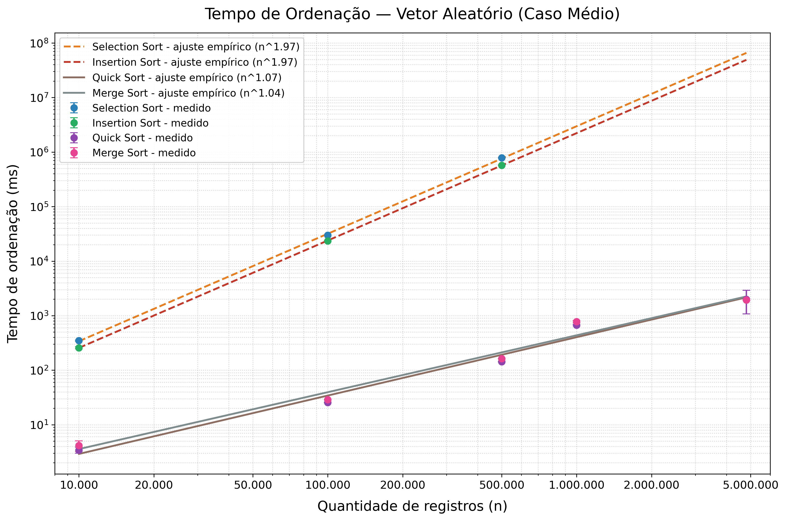
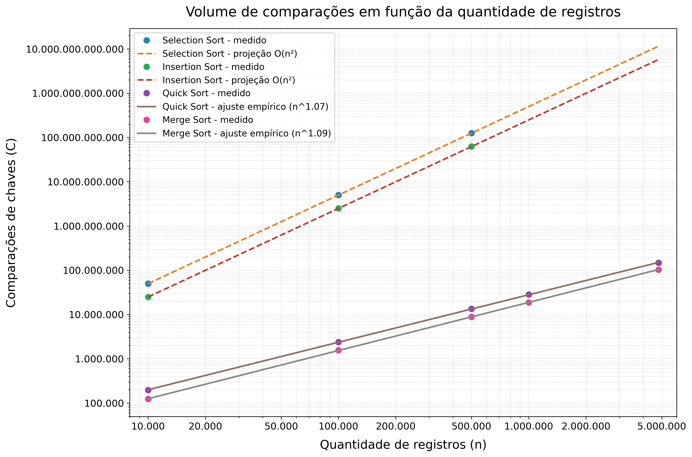
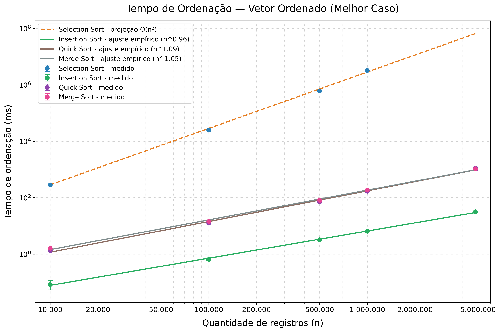
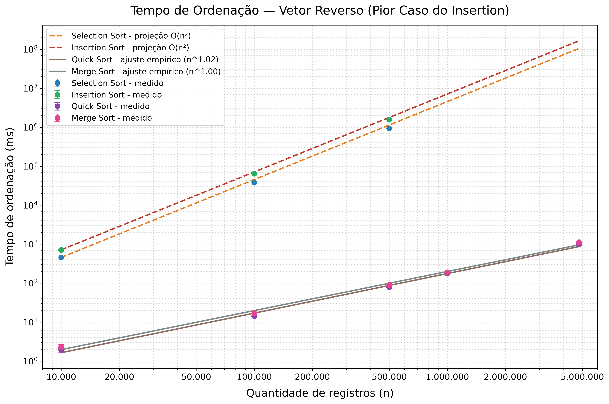

# Análise Experimental de Algoritmos de Ordenação sobre Dados do ENEM

Projeto acadêmico desenvolvido em C++20 para a análise experimental e comparação de algoritmos de ordenação aplicados a um conjunto de dados dos microdados do Exame Nacional do Ensino Médio (ENEM).

O trabalho investiga o comportamento de diferentes algoritmos diante de conjuntos de dados com diferentes quantidades e disposições iniciais, considerando métricas como tempo de execução, número de comparações, movimentações e utilização de memória.

O objetivo é relacionar a análise teórica da complexidade dos algoritmos com seu desempenho prático, observando como essas características se manifestam em diferentes cenários de execução.

## Algoritmos implementados

Foram implementados quatro algoritmos de ordenação:

- **Selection Sort:** algoritmo de ordenação por seleção, baseado na busca sucessiva do menor elemento.
- **Insertion Sort:** algoritmo de inserção, que organiza os elementos progressivamente.
- **Merge Sort:** implementação iterativa (*bottom-up*), baseada na divisão e intercalação de sequências ordenadas.
- **Quick Sort:** implementação híbrida, baseada na partição do conjunto e na ordenação recursiva de suas partes.

A ordenação utiliza a coluna `NU_INSCRICAO` como chave, considerando os registros como elementos ordenáveis.

## Métricas avaliadas

O desempenho dos algoritmos é analisado a partir das seguintes métricas:

- **Tempo de execução:** duração da operação de ordenação.
- **Comparações:** quantidade de comparações realizadas entre os elementos.
- **Movimentações:** quantidade de operações de movimentação de elementos contabilizadas pelas implementações.
- **Memória:** informações de utilização de memória do processo, incluindo métricas de memória residente, uso privado e respectivos picos, conforme os recursos disponibilizados pelo sistema operacional.

Os experimentos podem ser realizados com diferentes quantidades de registros e disposições iniciais:

- Ordenada;
- Inversamente ordenada;
- Aleatória.

Cada execução corresponde a um experimento individual, no qual são selecionados a quantidade de registros, o algoritmo e a disposição inicial dos dados.

## Arquitetura do projeto

O projeto foi organizado em módulos com responsabilidades específicas, buscando separar a implementação dos algoritmos, a preparação dos cenários, a execução dos experimentos e a coleta das métricas.

A estrutura principal é apresentada a seguir:

```text
Análises ENEM/
├── dataset/
│   └── banco.csv
│
├── src/
│   ├── Algoritmos/
│   ├── Cenarios/
│   ├── Dominio/
│   │   └── Tipos/
│   ├── Experimentos/
│   ├── Leitura/
│   ├── Medicao/
│   ├── Registro/
│   ├── Resultados/
│   ├── Terminal/
│   └── main.cpp
│
├── graficos/
│   ├── grafico_aleatorio.py
│   ├── grafico_comparacoes_aleatorio.py
│   ├── grafico_movimentacoes.py
│   ├── grafico_ordenado.py
│   └── grafico_reverso.py
│
├── apresentacao/
│   └── [PDF da apresentação]
│
├── artigo/
│   └── [PDF do artigo]
│
├── testes/
│   └── [PDF dos testes]
│
├── CMakeLists.txt
└── README.md
```

### Organização dos módulos

| Diretório | Responsabilidade |
|---|---|
| `src/Algoritmos/` | Implementação dos algoritmos de ordenação, classe-base e catálogo responsável pela criação das implementações. |
| `src/Cenarios/` | Geração dos cenários experimentais e preparação dos registros conforme a quantidade e a disposição inicial selecionadas. |
| `src/Dominio/Tipos/` | Definições dos tipos e enumerações utilizados para representar conceitos do domínio, como algoritmos e disposições iniciais. |
| `src/Experimentos/` | Coordenação da execução dos experimentos e integração entre algoritmos e mecanismos de medição. |
| `src/Leitura/` | Leitura e interpretação do arquivo CSV utilizado como fonte dos registros. |
| `src/Medicao/` | Componentes responsáveis pela medição de tempo e pela consulta às informações de memória do processo. |
| `src/Registro/` | Definição da estrutura que representa os registros utilizados durante a ordenação. |
| `src/Resultados/` | Estruturas e funcionalidades relacionadas ao armazenamento e à validação dos resultados dos experimentos. |
| `src/Terminal/` | Interface de interação pelo terminal, responsável por receber as opções do usuário e apresentar os resultados. |

### Fluxo geral de execução

O funcionamento do programa segue uma sequência de etapas:

1. Carregamento dos registros a partir do arquivo CSV.
2. Seleção da quantidade de registros, do algoritmo e da disposição inicial.
3. Geração do cenário experimental correspondente.
4. Criação da implementação do algoritmo selecionado.
5. Coleta das métricas e execução da ordenação.
6. Validação do resultado obtido.
7. Apresentação das informações do experimento no terminal.

Essa organização permite manter as responsabilidades separadas e reutilizar os componentes de execução e medição independentemente da interface utilizada.

## Gráficos dos resultados

Os gráficos apresentam visualmente os resultados obtidos nos experimentos, permitindo observar a relação entre a quantidade de registros e o comportamento dos algoritmos.

As imagens estão disponíveis na raiz do projeto, enquanto os respectivos scripts Python utilizados para gerá-las estão organizados no diretório `graficos/`.

Cada script possui o mesmo nome do arquivo de imagem correspondente, com a extensão `.py`.

### Gráficos disponíveis

#### 1. Tempo de execução — entradas aleatórias

Apresenta a relação entre a quantidade de registros e o tempo de execução dos algoritmos em entradas aleatórias, representando o cenário de caso médio considerado nos experimentos.

**Imagem:** `grafico_aleatorio.png`

**Script:** `graficos/grafico_aleatorio.py`



#### 2. Comparações — entradas aleatórias

Apresenta a quantidade de comparações realizadas pelos algoritmos em função do número de registros, considerando entradas aleatórias.

**Imagem:** `grafico_comparacoes_aleatorio.png`

**Script:** `graficos/grafico_comparacoes_aleatorio.py`



#### 3. Movimentações — entradas aleatórias

Apresenta a quantidade de movimentações realizadas pelos algoritmos em função do número de registros, permitindo comparar o custo associado à movimentação dos elementos.

**Imagem:** `grafico_movimentacoes.png`

**Script:** `graficos/grafico_movimentacoes.py`


#### 4. Tempo de execução — entradas ordenadas

Apresenta a relação entre a quantidade de registros e o tempo de execução dos algoritmos quando os dados já estão inicialmente ordenados.

**Imagem:** `grafico_ordenado.png`

**Script:** `graficos/grafico_ordenado.py`



#### 5. Tempo de execução — entradas inversamente ordenadas

Apresenta a relação entre a quantidade de registros e o tempo de execução dos algoritmos quando os dados estão inicialmente em ordem inversa.

**Imagem:** `grafico_reverso.png`

**Script:** `graficos/grafico_reverso.py`



### Como gerar os gráficos

Os gráficos podem ser reproduzidos por meio dos scripts Python disponíveis em `graficos/`.

É necessário possuir Python 3 e as bibliotecas utilizadas pelos scripts, como NumPy e Matplotlib.

Instale as dependências com:

```bash
python -m pip install numpy matplotlib
```

Na raiz do projeto, execute o script desejado:

```bash
python graficos/grafico_aleatorio.py
```

Para gerar os demais gráficos, basta executar os respectivos arquivos:

```bash
python graficos/grafico_comparacoes_aleatorio.py
python graficos/grafico_movimentacoes.py
python graficos/grafico_ordenado.py
python graficos/grafico_reverso.py
```

Os scripts utilizam os dados experimentais definidos em seus próprios arquivos e geram as imagens correspondentes na raiz do projeto.

## Dependências

Para compilar e executar o programa, são necessárias as seguintes ferramentas:

- **C++20:** padrão da linguagem utilizado no desenvolvimento.
- **Compilador C++:** GCC, Clang ou MSVC com suporte ao C++20.
- **CMake 3.21 ou superior:** configuração e gerenciamento do processo de compilação.
- **Qt 6.5 ou superior (Qt Core):** dependência utilizada pelo projeto.

Para a geração dos gráficos, também são necessárias:

- Python 3;
- NumPy;
- Matplotlib.

## Compilação e execução dos experimentos

O projeto utiliza CMake para configurar e compilar seus componentes.

Os comandos abaixo devem ser executados a partir da raiz do repositório.

### Windows

Com um compilador C++20, CMake e Qt 6 instalados e configurados:

**1. Configurar o projeto**

```bash
cmake -S . -B build
```

**2. Compilar em modo Release**

```bash
cmake --build build --config Release
```

**3. Executar o programa**

```powershell
.\build\analises_enem.exe
```

Em geradores de múltiplas configurações, como Visual Studio, o executável poderá ser gerado em:

```text
build/Release/analises_enem.exe
```

### Linux

Com GCC ou Clang, CMake e Qt 6 instalados:

**1. Configurar o projeto**

```bash
cmake -S . -B build
```

**2. Compilar em modo Release**

```bash
cmake --build build --config Release
```

**3. Executar o programa**

```bash
./build/analises_enem
```

Caso o Qt esteja instalado em um diretório personalizado, pode ser necessário informar sua localização ao CMake durante a configuração.

### Executando um benchmark

Após iniciar o programa, a interface de terminal solicitará as informações necessárias para a execução:

1. Quantidade de registros que serão utilizados.
2. Algoritmo de ordenação.
3. Disposição inicial dos registros.

Após a seleção, o programa prepara o cenário, executa o algoritmo e apresenta os resultados obtidos, incluindo tempo de execução, comparações, movimentações e informações de memória disponíveis.

Cada execução realiza um experimento individual. Para obter novas medições, basta executar novamente o programa e selecionar as configurações desejadas.

O arquivo de dados utilizado pelo programa está localizado em:

```text
dataset/banco.csv
```

Durante a configuração do projeto, o CMake disponibiliza esse arquivo no diretório de execução da aplicação.

**Recomendação para os experimentos:** utilize a compilação em modo `Release` para as medições de desempenho. Procure manter as condições de execução constantes entre os testes, evitando aplicações desnecessárias em segundo plano e registrando as configurações utilizadas. Isso reduz interferências externas e favorece a comparação dos resultados.

## Documentação acadêmica

Além do código-fonte, o repositório contém os documentos produzidos durante o desenvolvimento do trabalho:

- **Apresentação:** slides utilizados para apresentar o projeto e seus resultados, disponíveis em `apresentacao/`.
- **Artigo:** documento acadêmico com a contextualização, metodologia experimental, resultados e análise, disponível em `artigo/`.
- **Testes:** documentação dos testes realizados no projeto, disponível em `testes/`.

Os três documentos estão disponibilizados em formato PDF.

## Autores

- Vitor N. Souza
- Kauan F. Scheidt

**Instituto Federal Catarinense — Campus São Bento do Sul (IFC SBS)**

---

Projeto acadêmico desenvolvido para o estudo experimental e a comparação do desempenho de algoritmos de ordenação sobre dados dos microdados do ENEM.